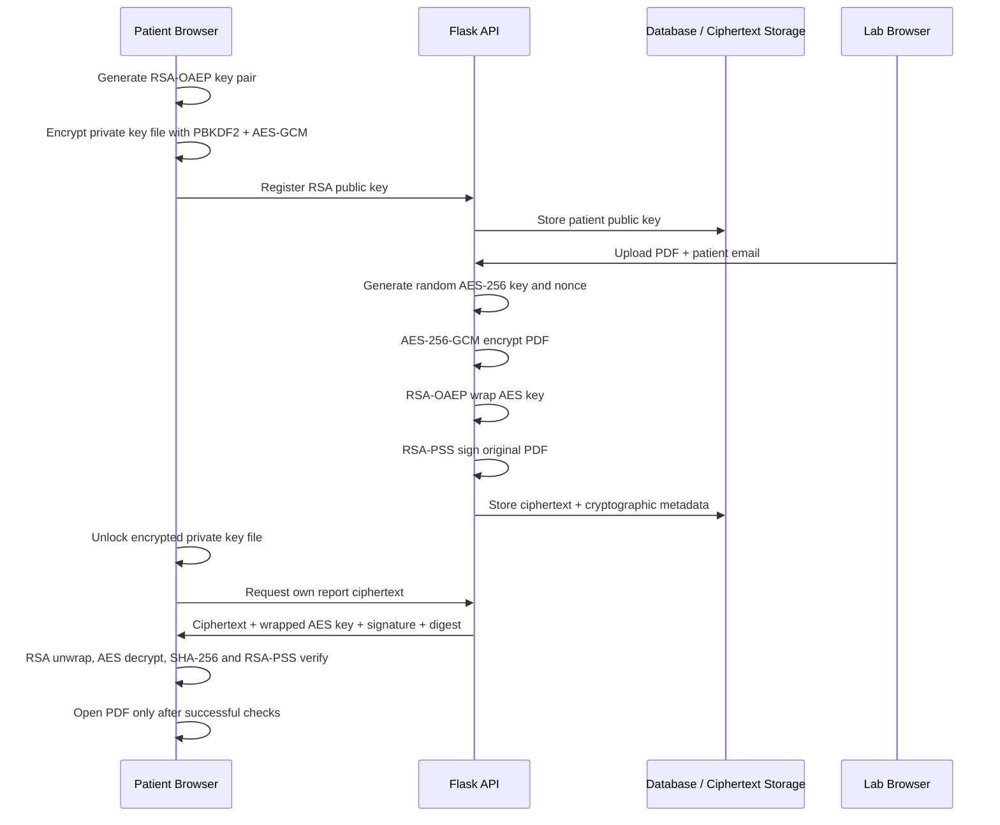

# SecureLab Architecture

## Components

- **React/Vite:** presentation layer, patient key generation, encrypted key-file handling, patient-side decryption and signature verification.
- **Flask API:** authentication, role checks, patient public-key registration, report processing and audit events.
- **SQLAlchemy database:** identity records, patient public keys, report metadata and audit trail.
- **Encrypted object/file storage:** ciphertext only; plaintext reports are processed in memory and are not persisted by the API.

## Trust boundaries

1. Browser to API: use HTTPS outside localhost. API JWT is held in React memory.
2. Patient browser to local key file: private key is protected by a passphrase-derived key; never transmit the private key.
3. Laboratory upload to backend: lab staff are trusted to submit the correct report for the selected patient. The backend validates the target patient and encrypts before writing to disk.
4. Backend storage: storage operators can see metadata and ciphertext but, absent the patient's private key, cannot unwrap the per-report AES key.
5. Hospital signing key: the signing key authenticates the issuing laboratory/system. Compromise of this key undermines authenticity; use an HSM/KMS in production.

## Report data model

Each report record contains a UUID, patient foreign key, uploading staff foreign key, report title/type, original filename, encrypted file path, RSA-wrapped AES key, AES-GCM nonce, RSA-PSS signature, SHA-256 digest and creation timestamp. The encrypted PDF file contains AES-GCM ciphertext plus its authentication tag.

## Sequence

